##  Projects

| | Project | What it does | Stack |
|:-:|:--|:--|:--|
|  | **[Semester Command](https://github.com/aalibrahimi/semester-command)** | Local-first desktop app that pulls Canvas coursework and tells you what to work on next | `Tauri` `React` `TypeScript` |
|  | **[Sentinel](https://github.com/aalibrahimi/Sentinal)** | Desktop stock monitor with your own alert rules and plain-language explanations | `Rust` `Alpaca` `Anthropic API` |
|  | **[SalahBond](https://github.com/aalibrahimi/SalahBond)** | iOS prayer companion with qadha tracking and a buddy system | `Expo` `React Native` |
|  | **[Axon by Takeover](https://github.com/aalibrahimi/cwa_takeover)** | MCP-native agent runtime that carries out real actions across SaaS tools | `Next.js` `MCP` `Supabase` |

 **Client sites, live:** [Noir Detailing](https://noir-detailing.vercel.app) · [Iraqi Sweets](https://iraqi-sweets.vercel.app) · [CodeWithAli](https://www.codewithali.com)

##  Stack

